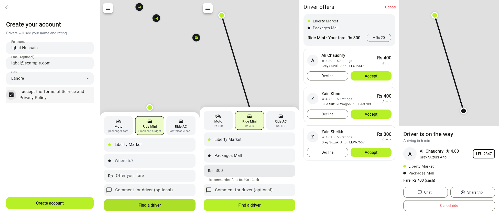
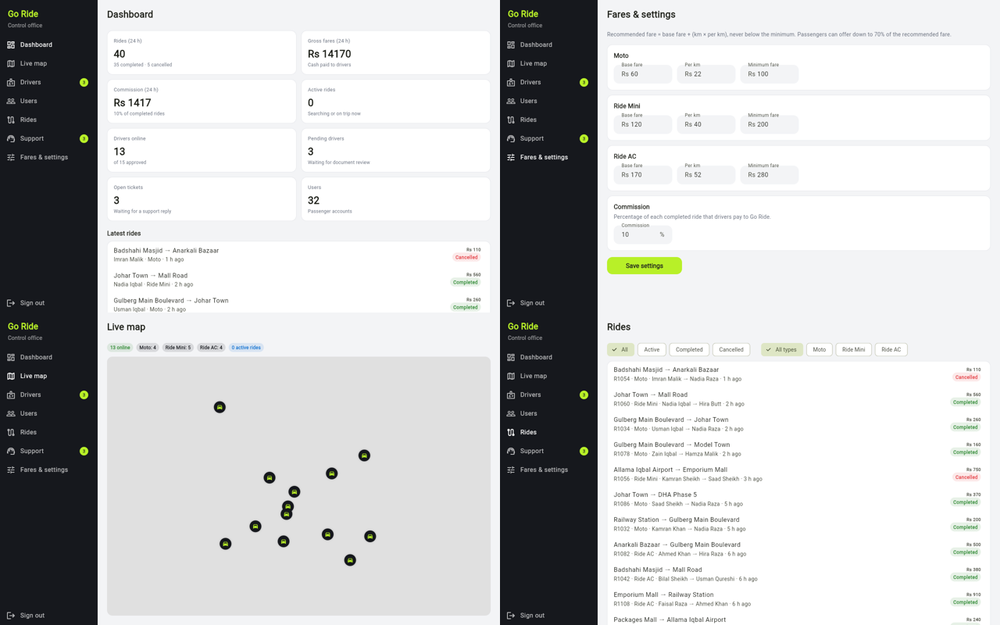

# MIK DRIVE

An inDrive-style ride-hailing app: the passenger names their own fare, and drivers accept it or send a counter-offer.

## What's built so far (MVP with demo data)

For review, the login screen has one-tap buttons that open the **Passenger**, **Driver** (already approved) and **Control office** panels without logging in.

**Accounts**
- Phone + OTP login (demo code: `1234`), new users create an account (name, email, city)
- Profile editing, blocked accounts cannot log in
- Separate passenger and driver ratings

**Services (like inDrive)**
- City rides (Moto / Ride Mini / Ride AC), City to City, Couriers (parcel with receiver details, size, fragile), Freight (Pickup / Shehzore / Mazda truck with cargo, weight and loading helpers) and Groceries (pick a store, add a shopping list and budget; the driver buys and delivers)

**Wallet and top-up**
- Top up with JazzCash, Easypaisa, card (instant) or bank transfer (approved by the control office)
- Passengers can pay rides from the wallet; commission is taken from the driver wallet after every ride
- Drivers with a balance below zero cannot go online until they top up

**Call, message and comments**
- In-app call screen (phone numbers hidden) and chat during the ride
- Rating with tags and a comment for both driver and passenger, visible to the control office

**Cities, zones and intercity**
- Lahore, Karachi and Islamabad, each with its own places, fares, commission, airport fee and enabled services
- Intercity trips between cities with departure time and seats; rides and couriers can be scheduled

**Safety**
- SOS alerts go to the control office with trip and driver details
- Daily driver selfie check, driving license expiry (expired licenses cannot go online)
- Suspicious account flags (frequent cancellations, low rating, large negative balance), warnings and suspensions

**Marketing**
- Promo codes (percent or fixed, usage limits, expiry); MIK DRIVE pays the driver the discount
- Referral codes: both users get a wallet bonus
- Driver bonuses ("complete N rides, earn Rs X"), notifications to everyone, passengers or drivers, and a passenger app banner

- Choose Moto / Ride Mini / Ride AC, pickup and destination, recommended fare
- Offer your own fare (down to 70% of recommended), comment for the driver
- Driver offers: Accept / Decline, raise fare by Rs 20
- Ride status, chat with driver, share trip, SOS, cancel with a reason, rate the driver
- Ride history, support tickets, FAQ, safety tips

**Driver mode** (switch from the side menu)
- Registration: CNIC, license, vehicle type/model/color/year/plate, 6 documents
- Application reviewed by the control office (pending / approved / rejected / blocked)
- Online / Offline, nearby requests for your vehicle type
- Accept the passenger's fare or counter-offer (+20/+50/+100)
- Ride flow with chat, cancel reasons, passenger rating
- Earnings card: net income, commission, rides, rating

**Control office** (demo: tap "Control office" on the login screen)
- Dashboard: rides, fares, commission, online drivers, pending drivers, open tickets
- Live map of online drivers
- Drivers: review documents, approve / reject with reason, block / unblock
- Users: search, view rides, block / unblock
- Rides: filter by status and type, full ride details, cancel active rides
- Support: reply to tickets with templates, close tickets
- Payments: approve or reject bank transfer top-ups, drivers below zero, all transactions, manual balance adjustment
- Driver withdrawals (mark paid / reject) and ride refunds to the passenger wallet
- Staff roles (Super admin, Support, Verification, Finance) with role-based pages, and an audit log of every staff action
- Safety: open SOS alerts, suspicious accounts, licenses to renew
- Marketing: promo codes, driver bonuses, notifications, banner
- Reports: ride requests per hour, fares by service, top drivers, CSV export
- Support tickets can be assigned to an agent; tickets open for over 2 hours show as overdue
- Fares & settings: base fare, per km, minimum fare per vehicle type, commission %




## Still to do
- [ ] Firebase backend (real login, real drivers/passengers, live location)
- [ ] Real GPS location and place search (geocoding); the moving car on the map is simulated
- [ ] Real document upload, push notifications (FCM), SMS OTP, payment gateways and phone calls
- [ ] Urdu language option

> All rides and drivers currently come from demo data in `lib/store.dart`.
> Once Firebase is connected, the same methods will talk to the real backend.

## Map (Google Maps, like inDrive)
The app uses **Google Maps** when a key is given at build time, otherwise a free English-label map (CARTO, OpenStreetMap data).
Pickup is chosen inDrive-style: move the map under the center pin.

```bash
flutter build web --release --dart-define=GOOGLE_MAPS_API_KEY=your_key
```

On Vercel add the environment variable `GOOGLE_MAPS_API_KEY` and use this build command:
```
flutter/bin/flutter config --enable-web && flutter/bin/flutter build web --release --dart-define=GOOGLE_MAPS_API_KEY=$GOOGLE_MAPS_API_KEY
```
If the key is wrong or missing, the app falls back to the free map automatically.
Google Maps on the Android/iOS apps still needs the key in the native settings (not set up yet).

## Running
```bash
flutter pub get
flutter run            # Android/iPhone
flutter run -d chrome  # in the browser
flutter test
```

## Code layout
```
lib/
  main.dart            app + login/mode routing
  models.dart          Ride, Offer, Driver, Place
  store.dart           app state (demo backend for now)
  theme.dart
  widgets/common.dart  map, side menu, history
  screens/login_screen.dart
  screens/passenger/   home, offers, ride
  screens/driver/      home (requests), registration, ride
```
