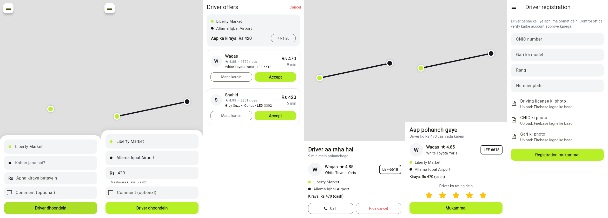
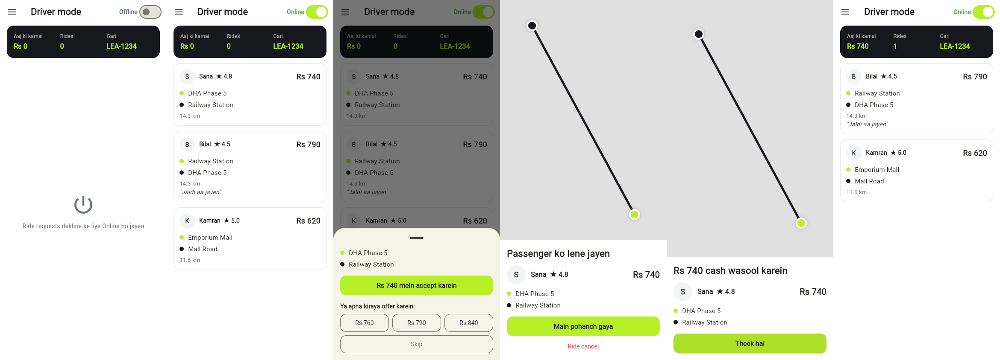

# Go Ride

inDrive jaisi ride-hailing app: passenger apna kiraya khud batata hai, drivers accept ya counter-offer karte hain.

## Abhi tak kya bana hai (MVP, demo data ke saath)

**Passenger mode**
- Phone + OTP login (demo code: `1234`)
- Map pe pickup / manzil chunna, mashwara kiraya
- Apna kiraya batana, comment
- Drivers ki offers: Accept / Mana karein, kiraya +Rs 20 barhana
- Ride status: driver aa raha hai, pohanch gaya, safar jaari, mukammal, rating

**Driver mode** (side menu se switch)
- Registration: CNIC, gari ka model, rang, number plate
- Online / Offline, qareeb ki ride requests
- Passenger ka kiraya accept karna ya apna kiraya offer karna (+20/+50/+100)
- Ride chalana: pohanch gaya, shuru, mukammal; aaj ki kamai




## Abhi baqi hai
- [ ] Firebase backend (asli login, asli drivers/passengers, live location)
- [ ] Control office (admin web panel)
- [ ] GPS se user ki asli location, jagah search (geocoding)
- [ ] Documents upload, notifications, in-app chat/call

> Abhi saari rides aur drivers `lib/store.dart` mein demo data se aate hain.
> Firebase lagne ke baad yahi methods asli backend se jud jayenge.

## Chalana
```bash
flutter pub get
flutter run            # Android/iPhone
flutter run -d chrome  # browser mein
flutter test
```

## Code ka dhancha
```
lib/
  main.dart            app + login/mode routing
  models.dart          Ride, Offer, Driver, Place
  store.dart           app ki state (abhi demo backend)
  theme.dart
  widgets/common.dart  map, side menu, history
  screens/login_screen.dart
  screens/passenger/   home, offers, ride
  screens/driver/      home (requests), registration, ride
```
